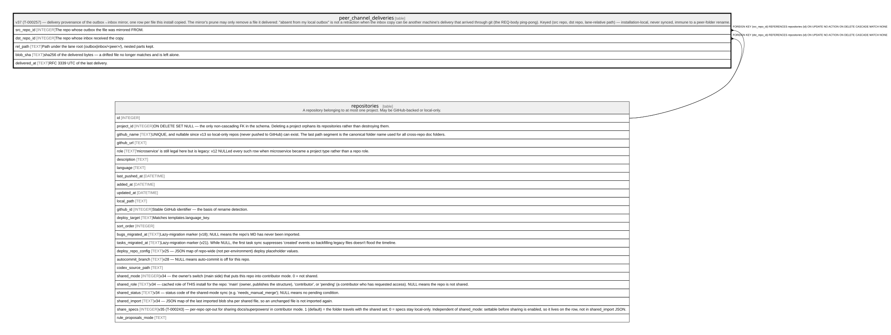

# peer_channel_deliveries

## Description

v37 (T-000257) — delivery provenance of the outbox→inbox mirror, one row per file this install copied. The mirror's prune may only remove a file it delivered: "absent from my local outbox" is not a retraction when the inbox copy can be another machine's delivery that arrived through git (the REQ-body ping-pong). Keyed (src repo, dst repo, lane-relative path) — installation-local, never synced, immune to a peer-folder rename.

<details>
<summary><strong>Table Definition</strong></summary>

```sql
CREATE TABLE peer_channel_deliveries (
             src_repo_id INTEGER NOT NULL REFERENCES repositories(id) ON DELETE CASCADE,
             dst_repo_id INTEGER NOT NULL REFERENCES repositories(id) ON DELETE CASCADE,
             rel_path TEXT NOT NULL,
             blob_sha TEXT NOT NULL,
             delivered_at TEXT NOT NULL,
             PRIMARY KEY (src_repo_id, dst_repo_id, rel_path)
         )
```

</details>

## Columns

| Name         | Type    | Default | Nullable | Children | Parents                         | Comment                                                                             |
| ------------ | ------- | ------- | -------- | -------- | ------------------------------- | ----------------------------------------------------------------------------------- |
| src_repo_id  | INTEGER |         | false    |          | [repositories](repositories.md) | The repo whose outbox the file was mirrored FROM.                                   |
| dst_repo_id  | INTEGER |         | false    |          | [repositories](repositories.md) | The repo whose inbox received the copy.                                             |
| rel_path     | TEXT    |         | false    |          |                                 | Path under the lane root (outbox\|inbox/\<peer\>/), nested parts kept.              |
| blob_sha     | TEXT    |         | false    |          |                                 | sha256 of the delivered bytes — a drifted file no longer matches and is left alone. |
| delivered_at | TEXT    |         | false    |          |                                 | RFC 3339 UTC of the last delivery.                                                  |

## Constraints

| Name                                       | Type        | Definition                                                                                              |
| ------------------------------------------ | ----------- | ------------------------------------------------------------------------------------------------------- |
| src_repo_id                                | PRIMARY KEY | PRIMARY KEY (src_repo_id)                                                                               |
| dst_repo_id                                | PRIMARY KEY | PRIMARY KEY (dst_repo_id)                                                                               |
| rel_path                                   | PRIMARY KEY | PRIMARY KEY (rel_path)                                                                                  |
| - (Foreign key ID: 0)                      | FOREIGN KEY | FOREIGN KEY (dst_repo_id) REFERENCES repositories (id) ON UPDATE NO ACTION ON DELETE CASCADE MATCH NONE |
| - (Foreign key ID: 1)                      | FOREIGN KEY | FOREIGN KEY (src_repo_id) REFERENCES repositories (id) ON UPDATE NO ACTION ON DELETE CASCADE MATCH NONE |
| sqlite_autoindex_peer_channel_deliveries_1 | PRIMARY KEY | PRIMARY KEY (src_repo_id, dst_repo_id, rel_path)                                                        |

## Indexes

| Name                                       | Definition                                                                                                           |
| ------------------------------------------ | -------------------------------------------------------------------------------------------------------------------- |
| idx_peer_channel_deliveries_pair           | CREATE INDEX idx_peer_channel_deliveries_pair<br />             ON peer_channel_deliveries(src_repo_id, dst_repo_id) |
| sqlite_autoindex_peer_channel_deliveries_1 | PRIMARY KEY (src_repo_id, dst_repo_id, rel_path)                                                                     |

## Relations



---

> Generated by [tbls](https://github.com/k1LoW/tbls)
