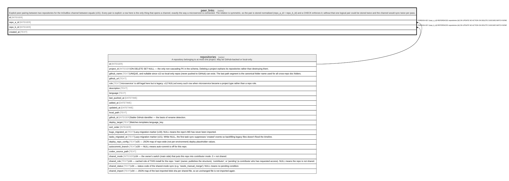

# peer_links

## Description

Explicit peer pairing between two repositories for the InOutBox channel between equals (v31). Every pair is explicit: a row here is the only thing that opens a channel, exactly the way a microservice is connected. The relation is symmetric, so the pair is stored normalised (repo_a_id < repo_b_id) and a CHECK enforces it; without that one logical pair could be stored twice and the channel would sync twice per pass.

<details>
<summary><strong>Table Definition</strong></summary>

```sql
CREATE TABLE peer_links (
             id INTEGER PRIMARY KEY AUTOINCREMENT,
             repo_a_id INTEGER NOT NULL REFERENCES repositories(id) ON DELETE CASCADE,
             repo_b_id INTEGER NOT NULL REFERENCES repositories(id) ON DELETE CASCADE,
             created_at TEXT NOT NULL,
             CHECK (repo_a_id <> repo_b_id),
             CHECK (repo_a_id < repo_b_id),
             UNIQUE (repo_a_id, repo_b_id)
         )
```

</details>

## Columns

| Name       | Type    | Default | Nullable | Children | Parents                         | Comment |
| ---------- | ------- | ------- | -------- | -------- | ------------------------------- | ------- |
| id         | INTEGER |         | true     |          |                                 |         |
| repo_a_id  | INTEGER |         | false    |          | [repositories](repositories.md) |         |
| repo_b_id  | INTEGER |         | false    |          | [repositories](repositories.md) |         |
| created_at | TEXT    |         | false    |          |                                 |         |

## Constraints

| Name                          | Type        | Definition                                                                                            |
| ----------------------------- | ----------- | ----------------------------------------------------------------------------------------------------- |
| id                            | PRIMARY KEY | PRIMARY KEY (id)                                                                                      |
| - (Foreign key ID: 0)         | FOREIGN KEY | FOREIGN KEY (repo_b_id) REFERENCES repositories (id) ON UPDATE NO ACTION ON DELETE CASCADE MATCH NONE |
| - (Foreign key ID: 1)         | FOREIGN KEY | FOREIGN KEY (repo_a_id) REFERENCES repositories (id) ON UPDATE NO ACTION ON DELETE CASCADE MATCH NONE |
| sqlite_autoindex_peer_links_1 | UNIQUE      | UNIQUE (repo_a_id, repo_b_id)                                                                         |
| -                             | CHECK       | CHECK (repo_a_id <> repo_b_id)                                                                        |
| -                             | CHECK       | CHECK (repo_a_id < repo_b_id)                                                                         |

## Indexes

| Name                          | Definition                                             |
| ----------------------------- | ------------------------------------------------------ |
| idx_peer_links_b              | CREATE INDEX idx_peer_links_b ON peer_links(repo_b_id) |
| idx_peer_links_a              | CREATE INDEX idx_peer_links_a ON peer_links(repo_a_id) |
| sqlite_autoindex_peer_links_1 | UNIQUE (repo_a_id, repo_b_id)                          |

## Relations



---

> Generated by [tbls](https://github.com/k1LoW/tbls)
