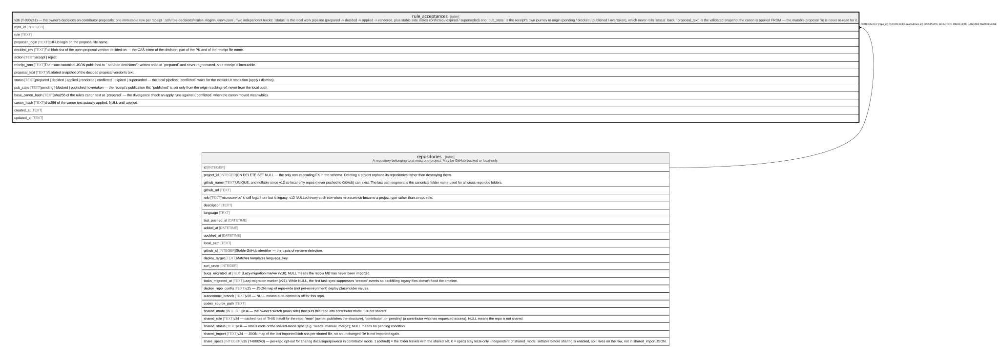

# rule_acceptances

## Description

v36 (T-000241) — the owner's decisions on contributor proposals: one immutable row per receipt `.sdh/rule-decisions/<rule>.<login>.<rev>.json`. Two independent tracks: `status` is the local work pipeline (prepared -> decided -> applied -> rendered, plus stable side states conflicted / expired / superseded) and `pub_state` is the receipt's own journey to origin (pending / blocked / published / overtaken), which never rolls `status` back. `proposal_text` is the validated snapshot the canon is applied FROM — the mutable proposal file is never re-read for it.

<details>
<summary><strong>Table Definition</strong></summary>

```sql
CREATE TABLE rule_acceptances (
             repo_id INTEGER NOT NULL REFERENCES repositories(id) ON DELETE CASCADE,
             rule TEXT NOT NULL,
             proposer_login TEXT NOT NULL,
             decided_rev TEXT NOT NULL,
             action TEXT NOT NULL CHECK (action IN ('accept','reject')),
             receipt_json TEXT NOT NULL,
             proposal_text TEXT NOT NULL,
             status TEXT NOT NULL CHECK (status IN ('prepared','decided','applied','rendered','conflicted','expired','superseded')),
             pub_state TEXT NOT NULL CHECK (pub_state IN ('pending','blocked','published','overtaken')),
             base_canon_hash TEXT NOT NULL,
             canon_hash TEXT,
             created_at TEXT NOT NULL,
             updated_at TEXT NOT NULL,
             PRIMARY KEY (repo_id, rule, proposer_login, decided_rev)
         )
```

</details>

## Columns

| Name            | Type    | Default | Nullable | Children | Parents                         | Comment                                                                                                                                                                      |
| --------------- | ------- | ------- | -------- | -------- | ------------------------------- | ---------------------------------------------------------------------------------------------------------------------------------------------------------------------------- |
| repo_id         | INTEGER |         | false    |          | [repositories](repositories.md) |                                                                                                                                                                              |
| rule            | TEXT    |         | false    |          |                                 |                                                                                                                                                                              |
| proposer_login  | TEXT    |         | false    |          |                                 | GitHub login on the proposal file name.                                                                                                                                      |
| decided_rev     | TEXT    |         | false    |          |                                 | Full blob sha of the open proposal version decided on — the CAS token of the decision; part of the PK and of the receipt file name.                                          |
| action          | TEXT    |         | false    |          |                                 | accept \| reject.                                                                                                                                                            |
| receipt_json    | TEXT    |         | false    |          |                                 | The exact canonical JSON published to `.sdh/rule-decisions/`; written once at `prepared` and never regenerated, so a receipt is immutable.                                   |
| proposal_text   | TEXT    |         | false    |          |                                 | Validated snapshot of the decided proposal version's text.                                                                                                                   |
| status          | TEXT    |         | false    |          |                                 | prepared \| decided \| applied \| rendered \| conflicted \| expired \| superseded — the local pipeline; `conflicted` waits for the explicit UI resolution (apply / dismiss). |
| pub_state       | TEXT    |         | false    |          |                                 | pending \| blocked \| published \| overtaken — the receipt's publication life; `published` is set only from the origin-tracking ref, never from the local push.              |
| base_canon_hash | TEXT    |         | false    |          |                                 | sha256 of the rule's canon text at `prepared` — the divergence check an apply runs against (`conflicted` when the canon moved meanwhile).                                    |
| canon_hash      | TEXT    |         | true     |          |                                 | sha256 of the canon text actually applied; NULL until applied.                                                                                                               |
| created_at      | TEXT    |         | false    |          |                                 |                                                                                                                                                                              |
| updated_at      | TEXT    |         | false    |          |                                 |                                                                                                                                                                              |

## Constraints

| Name                                | Type        | Definition                                                                                          |
| ----------------------------------- | ----------- | --------------------------------------------------------------------------------------------------- |
| repo_id                             | PRIMARY KEY | PRIMARY KEY (repo_id)                                                                               |
| rule                                | PRIMARY KEY | PRIMARY KEY (rule)                                                                                  |
| proposer_login                      | PRIMARY KEY | PRIMARY KEY (proposer_login)                                                                        |
| decided_rev                         | PRIMARY KEY | PRIMARY KEY (decided_rev)                                                                           |
| - (Foreign key ID: 0)               | FOREIGN KEY | FOREIGN KEY (repo_id) REFERENCES repositories (id) ON UPDATE NO ACTION ON DELETE CASCADE MATCH NONE |
| sqlite_autoindex_rule_acceptances_1 | PRIMARY KEY | PRIMARY KEY (repo_id, rule, proposer_login, decided_rev)                                            |
| -                                   | CHECK       | CHECK (action IN ('accept','reject'))                                                               |
| -                                   | CHECK       | CHECK (status IN ('prepared','decided','applied','rendered','conflicted','expired','superseded'))   |
| -                                   | CHECK       | CHECK (pub_state IN ('pending','blocked','published','overtaken'))                                  |

## Indexes

| Name                                | Definition                                                                |
| ----------------------------------- | ------------------------------------------------------------------------- |
| idx_rule_acceptances_repo           | CREATE INDEX idx_rule_acceptances_repo ON rule_acceptances(repo_id, rule) |
| sqlite_autoindex_rule_acceptances_1 | PRIMARY KEY (repo_id, rule, proposer_login, decided_rev)                  |

## Relations



---

> Generated by [tbls](https://github.com/k1LoW/tbls)
