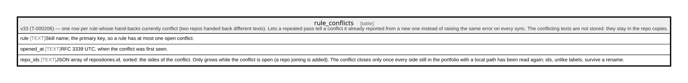

# rule_conflicts

## Description

v33 (T-000206) — one row per rule whose hand-backs currently conflict (two repos handed back different texts). Lets a repeated pass tell a conflict it already reported from a new one instead of raising the same error on every sync. The conflicting texts are not stored: they stay in the repo copies.

<details>
<summary><strong>Table Definition</strong></summary>

```sql
CREATE TABLE rule_conflicts (
             rule TEXT PRIMARY KEY,
             opened_at TEXT NOT NULL,
             repo_ids TEXT NOT NULL
         )
```

</details>

## Columns

| Name      | Type | Default | Nullable | Children | Parents | Comment                                                                                                                                                                                                                                                                         |
| --------- | ---- | ------- | -------- | -------- | ------- | ------------------------------------------------------------------------------------------------------------------------------------------------------------------------------------------------------------------------------------------------------------------------------- |
| rule      | TEXT |         | true     |          |         | Skill name; the primary key, so a rule has at most one open conflict.                                                                                                                                                                                                           |
| opened_at | TEXT |         | false    |          |         | RFC 3339 UTC, when the conflict was first seen.                                                                                                                                                                                                                                 |
| repo_ids  | TEXT |         | false    |          |         | JSON array of repositories.id, sorted: the sides of the conflict. Only grows while the conflict is open (a repo joining is added). The conflict closes only once every side still in the portfolio with a local path has been read again; ids, unlike labels, survive a rename. |

## Constraints

| Name                              | Type        | Definition         |
| --------------------------------- | ----------- | ------------------ |
| rule                              | PRIMARY KEY | PRIMARY KEY (rule) |
| sqlite_autoindex_rule_conflicts_1 | PRIMARY KEY | PRIMARY KEY (rule) |

## Indexes

| Name                              | Definition         |
| --------------------------------- | ------------------ |
| sqlite_autoindex_rule_conflicts_1 | PRIMARY KEY (rule) |

## Relations



---

> Generated by [tbls](https://github.com/k1LoW/tbls)
