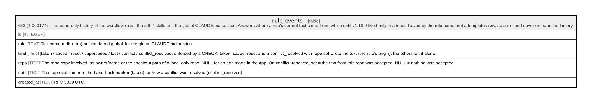

# rule_events

## Description

v33 (T-000174) — append-only history of the workflow rules: the sdh-* skills and the global CLAUDE.md section. Answers where a rule's current text came from, which until v1.19.0 lived only in a toast. Keyed by the rule name, not a templates row, so a re-seed never orphans the history.

<details>
<summary><strong>Table Definition</strong></summary>

```sql
CREATE TABLE rule_events (
             id INTEGER PRIMARY KEY AUTOINCREMENT,
             rule TEXT NOT NULL,
             kind TEXT NOT NULL CHECK (kind IN ('taken','saved','reset','superseded','lost','conflict','conflict_resolved')),
             repo TEXT,
             note TEXT,
             created_at TEXT NOT NULL
         )
```

</details>

## Columns

| Name       | Type    | Default | Nullable | Children | Parents | Comment                                                                                                                                                                                                                |
| ---------- | ------- | ------- | -------- | -------- | ------- | ---------------------------------------------------------------------------------------------------------------------------------------------------------------------------------------------------------------------- |
| id         | INTEGER |         | true     |          |         |                                                                                                                                                                                                                        |
| rule       | TEXT    |         | false    |          |         | Skill name (sdh-retro) or 'claude.md.global' for the global CLAUDE.md section.                                                                                                                                         |
| kind       | TEXT    |         | false    |          |         | taken / saved / reset / superseded / lost / conflict / conflict_resolved, enforced by a CHECK. taken, saved, reset and a conflict_resolved with repo set wrote the text (the rule's origin); the others left it alone. |
| repo       | TEXT    |         | true     |          |         | The repo copy involved, as owner/name or the checkout path of a local-only repo; NULL for an edit made in the app. On conflict_resolved, set = the text from this repo was accepted, NULL = nothing was accepted.      |
| note       | TEXT    |         | true     |          |         | The approval line from the hand-back marker (taken), or how a conflict was resolved (conflict_resolved).                                                                                                               |
| created_at | TEXT    |         | false    |          |         | RFC 3339 UTC.                                                                                                                                                                                                          |

## Constraints

| Name | Type        | Definition                                                                                   |
| ---- | ----------- | -------------------------------------------------------------------------------------------- |
| id   | PRIMARY KEY | PRIMARY KEY (id)                                                                             |
| -    | CHECK       | CHECK (kind IN ('taken','saved','reset','superseded','lost','conflict','conflict_resolved')) |

## Indexes

| Name                 | Definition                                                         |
| -------------------- | ------------------------------------------------------------------ |
| idx_rule_events_rule | CREATE INDEX idx_rule_events_rule ON rule_events(rule, created_at) |

## Relations



---

> Generated by [tbls](https://github.com/k1LoW/tbls)
