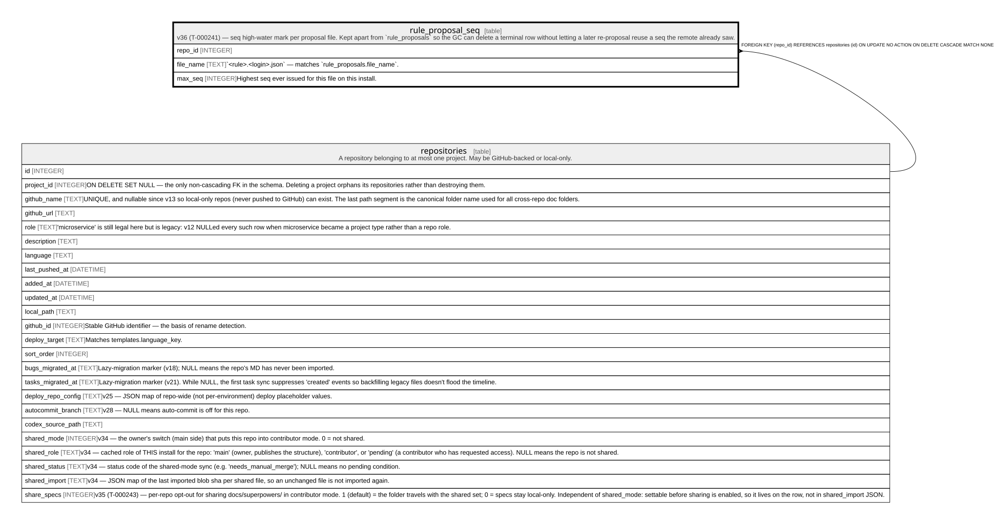

# rule_proposal_seq

## Description

v36 (T-000241) — seq high-water mark per proposal file. Kept apart from `rule_proposals` so the GC can delete a terminal row without letting a later re-proposal reuse a seq the remote already saw.

<details>
<summary><strong>Table Definition</strong></summary>

```sql
CREATE TABLE rule_proposal_seq (
             repo_id INTEGER NOT NULL REFERENCES repositories(id) ON DELETE CASCADE,
             file_name TEXT NOT NULL,
             max_seq INTEGER NOT NULL,
             PRIMARY KEY (repo_id, file_name)
         )
```

</details>

## Columns

| Name      | Type    | Default | Nullable | Children | Parents                         | Comment                                                         |
| --------- | ------- | ------- | -------- | -------- | ------------------------------- | --------------------------------------------------------------- |
| repo_id   | INTEGER |         | false    |          | [repositories](repositories.md) |                                                                 |
| file_name | TEXT    |         | false    |          |                                 | `\<rule\>.\<login\>.json` — matches `rule_proposals.file_name`. |
| max_seq   | INTEGER |         | false    |          |                                 | Highest seq ever issued for this file on this install.          |

## Constraints

| Name                                 | Type        | Definition                                                                                          |
| ------------------------------------ | ----------- | --------------------------------------------------------------------------------------------------- |
| repo_id                              | PRIMARY KEY | PRIMARY KEY (repo_id)                                                                               |
| file_name                            | PRIMARY KEY | PRIMARY KEY (file_name)                                                                             |
| - (Foreign key ID: 0)                | FOREIGN KEY | FOREIGN KEY (repo_id) REFERENCES repositories (id) ON UPDATE NO ACTION ON DELETE CASCADE MATCH NONE |
| sqlite_autoindex_rule_proposal_seq_1 | PRIMARY KEY | PRIMARY KEY (repo_id, file_name)                                                                    |

## Indexes

| Name                                 | Definition                       |
| ------------------------------------ | -------------------------------- |
| sqlite_autoindex_rule_proposal_seq_1 | PRIMARY KEY (repo_id, file_name) |

## Relations



---

> Generated by [tbls](https://github.com/k1LoW/tbls)
