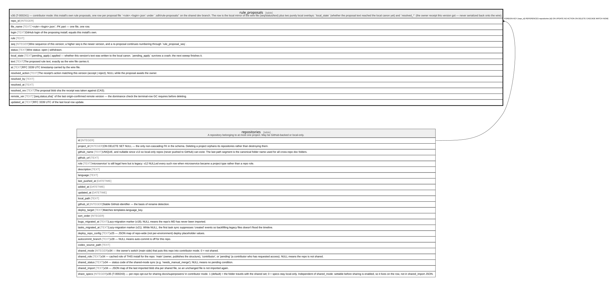

# rule_proposals

## Description

v36 (T-000241) — contributor mode: this install's own rule proposals, one row per proposal file `<rule>.<login>.json` under `.sdh/rule-proposals/` on the shared dev branch. The row is the local mirror of the wire file (seq/status/text) plus two purely local overlays: `local_state` (whether the proposal text reached the local canon yet) and `resolved_*` (the owner receipt this version got — never serialized back onto the wire).

<details>
<summary><strong>Table Definition</strong></summary>

```sql
CREATE TABLE rule_proposals (
             repo_id INTEGER NOT NULL REFERENCES repositories(id) ON DELETE CASCADE,
             file_name TEXT NOT NULL,
             login TEXT NOT NULL,
             rule TEXT NOT NULL,
             seq INTEGER NOT NULL,
             status TEXT NOT NULL CHECK (status IN ('open','withdrawn')),
             local_state TEXT NOT NULL CHECK (local_state IN ('pending_apply','applied')),
             text TEXT NOT NULL,
             at TEXT NOT NULL,
             resolved_action TEXT,
             resolved_by TEXT,
             resolved_at TEXT,
             resolved_rev TEXT,
             remote_ver TEXT,
             updated_at TEXT NOT NULL,
             PRIMARY KEY (repo_id, file_name)
         )
```

</details>

## Columns

| Name            | Type    | Default | Nullable | Children | Parents                         | Comment                                                                                                                                              |
| --------------- | ------- | ------- | -------- | -------- | ------------------------------- | ---------------------------------------------------------------------------------------------------------------------------------------------------- |
| repo_id         | INTEGER |         | false    |          | [repositories](repositories.md) |                                                                                                                                                      |
| file_name       | TEXT    |         | false    |          |                                 | `\<rule\>.\<login\>.json`; PK part — one file, one row.                                                                                              |
| login           | TEXT    |         | false    |          |                                 | GitHub login of the proposing install; equals this install's own.                                                                                    |
| rule            | TEXT    |         | false    |          |                                 |                                                                                                                                                      |
| seq             | INTEGER |         | false    |          |                                 | Wire sequence of this version; a higher seq is the newer version, and a re-proposal continues numbering through `rule_proposal_seq`.                 |
| status          | TEXT    |         | false    |          |                                 | Wire status: open \| withdrawn.                                                                                                                      |
| local_state     | TEXT    |         | false    |          |                                 | pending_apply \| applied — whether this version's text was written to the local canon. `pending_apply` survives a crash; the next sweep finishes it. |
| text            | TEXT    |         | false    |          |                                 | The proposed rule text, exactly as the wire file carries it.                                                                                         |
| at              | TEXT    |         | false    |          |                                 | RFC 3339 UTC timestamp carried by the wire file.                                                                                                     |
| resolved_action | TEXT    |         | true     |          |                                 | The receipt's action matching this version (accept \| reject); NULL while the proposal awaits the owner.                                             |
| resolved_by     | TEXT    |         | true     |          |                                 |                                                                                                                                                      |
| resolved_at     | TEXT    |         | true     |          |                                 |                                                                                                                                                      |
| resolved_rev    | TEXT    |         | true     |          |                                 | The proposal blob sha the receipt was taken against (CAS).                                                                                           |
| remote_ver      | TEXT    |         | true     |          |                                 | `{seq,status,sha}` of the last origin-confirmed remote version — the dominance check the terminal-row GC requires before deleting.                   |
| updated_at      | TEXT    |         | false    |          |                                 | RFC 3339 UTC of the last local row update.                                                                                                           |

## Constraints

| Name                              | Type        | Definition                                                                                          |
| --------------------------------- | ----------- | --------------------------------------------------------------------------------------------------- |
| repo_id                           | PRIMARY KEY | PRIMARY KEY (repo_id)                                                                               |
| file_name                         | PRIMARY KEY | PRIMARY KEY (file_name)                                                                             |
| - (Foreign key ID: 0)             | FOREIGN KEY | FOREIGN KEY (repo_id) REFERENCES repositories (id) ON UPDATE NO ACTION ON DELETE CASCADE MATCH NONE |
| sqlite_autoindex_rule_proposals_1 | PRIMARY KEY | PRIMARY KEY (repo_id, file_name)                                                                    |
| -                                 | CHECK       | CHECK (status IN ('open','withdrawn'))                                                              |
| -                                 | CHECK       | CHECK (local_state IN ('pending_apply','applied'))                                                  |

## Indexes

| Name                              | Definition                                                            |
| --------------------------------- | --------------------------------------------------------------------- |
| idx_rule_proposals_repo           | CREATE INDEX idx_rule_proposals_repo ON rule_proposals(repo_id, rule) |
| sqlite_autoindex_rule_proposals_1 | PRIMARY KEY (repo_id, file_name)                                      |

## Relations



---

> Generated by [tbls](https://github.com/k1LoW/tbls)
